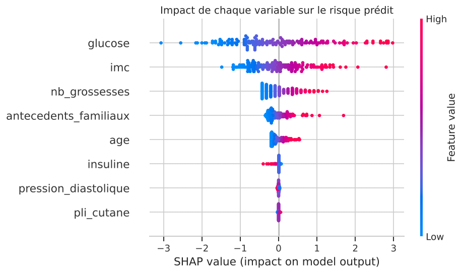
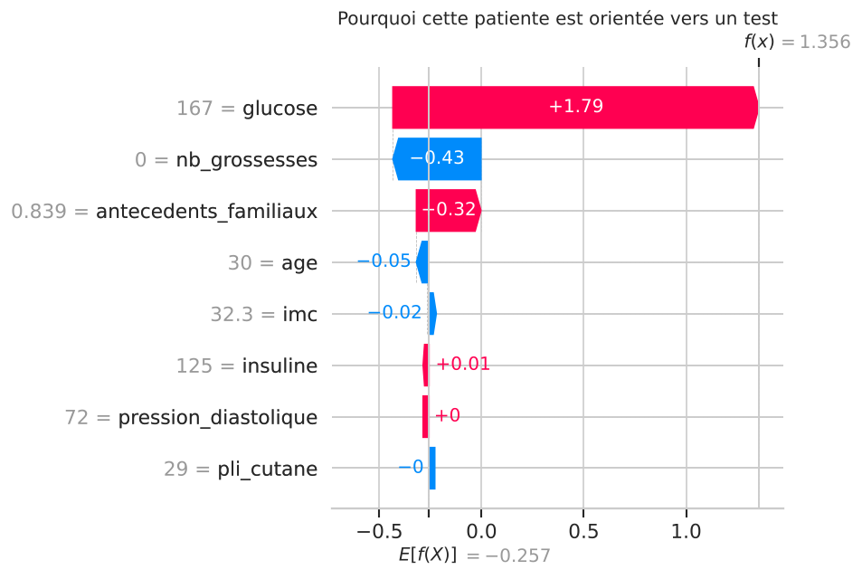
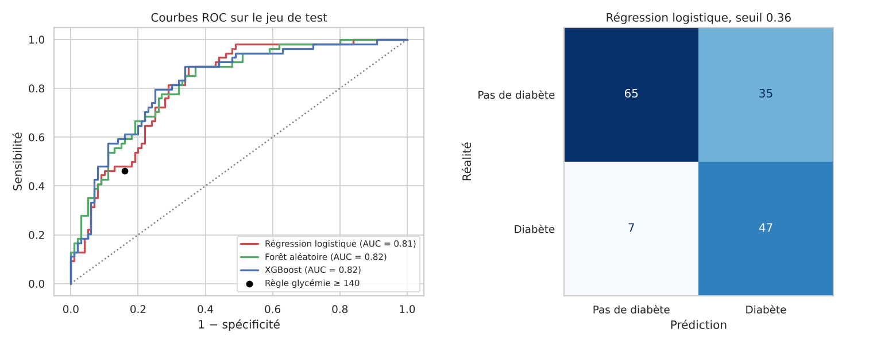

# Dépistage du diabète de type 2 par machine learning

À partir de mesures simples prises en consultation (glycémie, IMC, âge, tension...), ce projet estime le **risque qu'une patiente développe un diabète de type 2 dans les 5 ans**, choisit un **seuil adapté au dépistage** (ne pas rater de malades), vérifie que les probabilités sont fiables et **explique chaque prédiction** avec SHAP.

👉 Tout est dans le notebook : [`notebooks/depistage_diabete.ipynb`](notebooks/depistage_diabete.ipynb)

> ⚠️ Projet pédagogique : ce modèle n'est pas un dispositif médical et ne remplace pas un diagnostic.

## Résultats

Évaluation finale sur 154 patientes jamais vues pendant l'entraînement, avec un seuil réglé pour détecter au moins 85 % des malades :

| Approche | AUC | Sensibilité | Spécificité | Malades ratées |
|---|---|---|---|---|
| Règle clinique « glycémie ≥ 140 mg/dL » | 0,65 | 46 % | 84 % | 29 / 54 |
| Forêt aléatoire | 0,82 | 85 % | 66 % | 8 / 54 |
| XGBoost | 0,82 | 87 % | 66 % | 7 / 54 |
| **Régression logistique (retenue)** | **0,81** | **87 %** | **65 %** | **7 / 54** |

- Le modèle détecte **87 % des malades**, contre 46 % pour la règle glycémie seule : il rate 4 fois moins de patientes.
- En validation croisée répétée (25 entraînements), la **régression logistique est la meilleure** (AUC 0,84 ± 0,03, contre 0,82 pour XGBoost). Sur ce petit jeu tabulaire, un modèle simple suffit, et en santé c'est un atout : il est plus facile à faire valider par des médecins.
- Le seuil de dépistage est de **0,36** (et non 0,5) : rater une malade coûte plus cher qu'une fausse alerte, qui sera levée par un test de confirmation (HbA1c).
- Les facteurs les plus influents sont la **glycémie** (risque × 3,3 par écart-type), l'**IMC** (× 2), le **nombre de grossesses** et les **antécédents familiaux** : cohérent avec la littérature médicale.

<p align="center">
  
  
</p>

*À gauche : impact global de chaque variable. À droite : pourquoi une patiente précise est orientée vers un test (glycémie de 167 mg/dL).*

<p align="center">
  
</p>

## Démarche

1. **Nettoyage** : dans le fichier brut, les mesures manquantes sont codées 0 (une glycémie ou un IMC nul est impossible). Elles sont remplacées par des valeurs manquantes, puis imputées par la médiane **à l'intérieur du pipeline**, pour éviter toute fuite de données.
2. **Exploration** : distributions par diagnostic, corrélations.
3. **Référence clinique** : la règle « glycémie à 2 h ≥ 140 mg/dL » (seuil d'intolérance au glucose de l'OMS).
4. **Comparaison de modèles** : régression logistique, forêt aléatoire, XGBoost, en validation croisée 5 plis répétée 5 fois (un seul découpage serait trop instable sur 614 patientes).
5. **Seuil de dépistage** : plus grand seuil qui garantit 85 % de sensibilité, calculé sur des prédictions hors plis, sans toucher au jeu de test.
6. **Calibration** : les modèles rééquilibrés surestiment le risque ; à corriger avant d'annoncer une probabilité à une patiente.
7. **Explicabilité** : odds ratios, SHAP global et SHAP individuel.

**Pourquoi la sensibilité ?** En dépistage, un faux négatif (une malade rassurée à tort) est bien plus grave qu'un faux positif. On fixe donc la sensibilité minimale, puis on regarde ce que cela coûte en spécificité et en nombre de patientes orientées vers un test.

## Lancer le projet

```bash
git clone <url-de-ton-repo>
cd depistage-diabete
python -m venv .venv && source .venv/bin/activate   # Windows : .venv\Scripts\activate
pip install -r requirements.txt
jupyter notebook notebooks/depistage_diabete.ipynb
```

Les données sont incluses dans `data/`. Si le fichier est supprimé, il est retéléchargé automatiquement (aucun compte nécessaire).

Tests : `pytest`. Pour régénérer le notebook : `python scripts/build_notebook.py`.

## Structure

```
depistage-diabete/
├── data/diabetes.csv              # données brutes (768 patientes)
├── notebooks/depistage_diabete.ipynb
├── src/
│   ├── data.py                    # chargement, noms en français, zéros impossibles
│   └── model.py                   # modèles, validation croisée, seuil de dépistage, métriques
├── scripts/build_notebook.py      # génère le notebook
├── reports/figures/               # graphiques générés par le notebook
├── results/                       # tableaux de résultats (CSV)
├── tests/test_pipeline.py
└── requirements.txt
```

## Limites et pistes

- 768 patientes d'une seule population (femmes d'origine pima, Arizona) : le modèle ne se généralise pas tel quel à d'autres populations.
- Près de la moitié des dosages d'insuline manquent.
- Les probabilités ne sont pas calibrées à cause du rééquilibrage des classes.

**Prochaines étapes envisagées :** recalibration (isotonique), validation externe sur une autre cohorte (NHANES), audit d'équité par tranche d'âge, application Streamlit pour les soignants.

## Données

Smith, J. W., Everhart, J. E., Dickson, W. C., Knowler, W. C., & Johannes, R. S. (1988). *Using the ADAP learning algorithm to forecast the onset of diabetes mellitus*. Proceedings of the Symposium on Computer Applications in Medical Care, 261-265. Données du National Institute of Diabetes and Digestive and Kidney Diseases (NIDDK), diffusées par l'UCI Machine Learning Repository et Kaggle.

## Auteur

**Issa Aziz Karambiri**, étudiant ingénieur en mathématiques appliquées (data, IA, finance).
